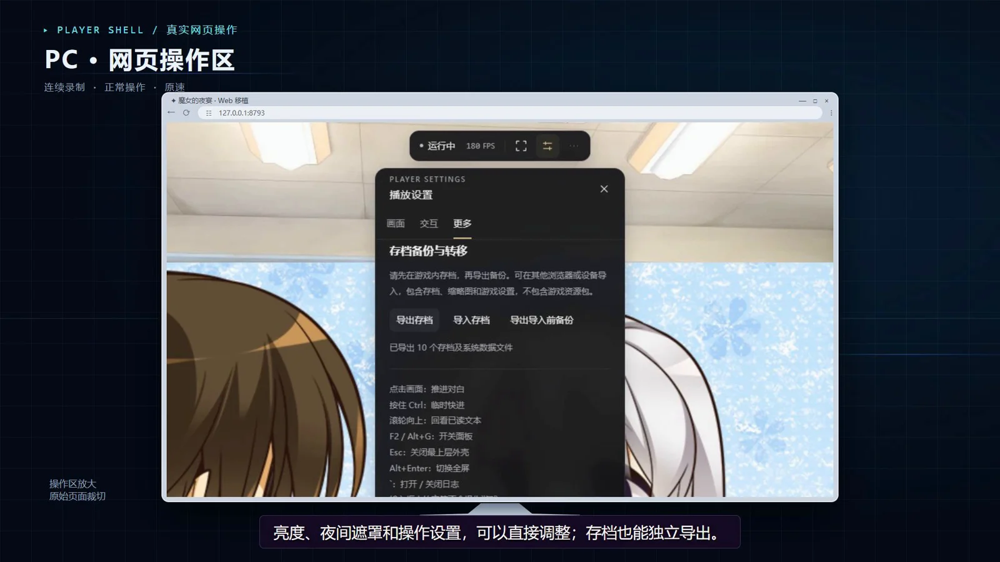

# 魔女的夜宴 · Web

**熟悉的角色，原来的故事，一个新的窗口。**

[**▶ 打开网页版**](https://2chariko.github.io/sabbat-web/)　 ·　[下载播放器](https://github.com/2CHariko/sabbat-web/releases/latest)　 ·　[观看介绍短片](https://github.com/2CHariko/sabbat-web/releases/download/v1.0.0/sabbat-web-intro-v1.2.0.mp4)

`WebAssembly`　 `本地资源`　 `存档转移`　 `PC / 平板 / Android`

## 让故事继续

将《魔女的夜宴》的演出带进浏览器：原作脚本继续推进对白、选项和场景，视频与画面交还引擎图层，网页提供适合鼠标与触屏的操作入口。

| 原来的故事 | 新的操作方式 | 由你保管的进度 |
| :--- | :--- | :--- |
| 立绘、文字、选项、SD 演出与视频播放 | 桌面控制条、触屏悬浮球、播放设置 | 本地读取游戏分卷，导出与导入存档 |

**全平台运行。** 已验证 PC Chrome、Android Chrome；设备外框为展示示意，介绍图中的平板和手机画面通过真实网页触摸仿真录制。

## 三步开始

1. **下载资源**：从下方表格下载 **index、001、002、003 四个 `.gpack` 文件**，放在同一文件夹。无需解压，旧试玩资源和不同集合不能混用。
2. **打开页面**：[进入网页版](https://2chariko.github.io/sabbat-web/)，选择全部文件，或选择存放这一整套文件的文件夹。手机可使用页面中的普通文件选择入口。
3. **进入游戏**：资源校验通过后进入标题画面。建议横屏游玩，并先点击页面以启用声音。

游戏资源通过浏览器本地文件接口读取，不上传你选择的资源。资源包单独放在 Release 附件中，当前资源兼容信息见 [使用说明](docs/usage.md)。

## 下载游戏资源

**在线玩：四个 .gpack 全部下载，总计 3.53 GB。** 无需解压、合并或改名；打开网页版后同时选择这四个文件。

| 文件 | 大小 | 用途 |
| --- | ---: | --- |
| `sabbat-compact-1536mib-index.gpack` | 33.24 MB | 索引，必下 |
| `sabbat-compact-1536mib-001.gpack` | 1.60 GB | 第 1 卷，必下 |
| `sabbat-compact-1536mib-002.gpack` | 1.61 GB | 第 2 卷，必下 |
| `sabbat-compact-1536mib-003.gpack` | 286.62 MB | 第 3 卷，必下 |

### 国内访问备用下载

| 下载通道 | 索引 index | 第 1 卷 001 | 第 2 卷 002 | 第 3 卷 003 | 校验表 |
| --- | --- | --- | --- | --- | --- |
| GitHub 原站 | [下载](https://github.com/2CHariko/sabbat-web/releases/download/v1.0.0/sabbat-compact-1536mib-index.gpack) | [下载](https://github.com/2CHariko/sabbat-web/releases/download/v1.0.0/sabbat-compact-1536mib-001.gpack) | [下载](https://github.com/2CHariko/sabbat-web/releases/download/v1.0.0/sabbat-compact-1536mib-002.gpack) | [下载](https://github.com/2CHariko/sabbat-web/releases/download/v1.0.0/sabbat-compact-1536mib-003.gpack) | [SHA-256](https://github.com/2CHariko/sabbat-web/releases/download/v1.0.0/RESOURCES-SHA256SUMS.txt) |
| ghfast.top | [下载](https://ghfast.top/https://github.com/2CHariko/sabbat-web/releases/download/v1.0.0/sabbat-compact-1536mib-index.gpack) | [下载](https://ghfast.top/https://github.com/2CHariko/sabbat-web/releases/download/v1.0.0/sabbat-compact-1536mib-001.gpack) | [下载](https://ghfast.top/https://github.com/2CHariko/sabbat-web/releases/download/v1.0.0/sabbat-compact-1536mib-002.gpack) | [下载](https://ghfast.top/https://github.com/2CHariko/sabbat-web/releases/download/v1.0.0/sabbat-compact-1536mib-003.gpack) | [SHA-256](https://ghfast.top/https://github.com/2CHariko/sabbat-web/releases/download/v1.0.0/RESOURCES-SHA256SUMS.txt) |
| ghproxy.net | [下载](https://ghproxy.net/https://github.com/2CHariko/sabbat-web/releases/download/v1.0.0/sabbat-compact-1536mib-index.gpack) | [下载](https://ghproxy.net/https://github.com/2CHariko/sabbat-web/releases/download/v1.0.0/sabbat-compact-1536mib-001.gpack) | [下载](https://ghproxy.net/https://github.com/2CHariko/sabbat-web/releases/download/v1.0.0/sabbat-compact-1536mib-002.gpack) | [下载](https://ghproxy.net/https://github.com/2CHariko/sabbat-web/releases/download/v1.0.0/sabbat-compact-1536mib-003.gpack) | [SHA-256](https://ghproxy.net/https://github.com/2CHariko/sabbat-web/releases/download/v1.0.0/RESOURCES-SHA256SUMS.txt) |
| gh-proxy.com | [下载](https://gh-proxy.com/https://github.com/2CHariko/sabbat-web/releases/download/v1.0.0/sabbat-compact-1536mib-index.gpack) | [下载](https://gh-proxy.com/https://github.com/2CHariko/sabbat-web/releases/download/v1.0.0/sabbat-compact-1536mib-001.gpack) | [下载](https://gh-proxy.com/https://github.com/2CHariko/sabbat-web/releases/download/v1.0.0/sabbat-compact-1536mib-002.gpack) | [下载](https://gh-proxy.com/https://github.com/2CHariko/sabbat-web/releases/download/v1.0.0/sabbat-compact-1536mib-003.gpack) | [SHA-256](https://gh-proxy.com/https://github.com/2CHariko/sabbat-web/releases/download/v1.0.0/RESOURCES-SHA256SUMS.txt) |
| gh.llkk.cc | [下载](https://gh.llkk.cc/https://github.com/2CHariko/sabbat-web/releases/download/v1.0.0/sabbat-compact-1536mib-index.gpack) | [下载](https://gh.llkk.cc/https://github.com/2CHariko/sabbat-web/releases/download/v1.0.0/sabbat-compact-1536mib-001.gpack) | [下载](https://gh.llkk.cc/https://github.com/2CHariko/sabbat-web/releases/download/v1.0.0/sabbat-compact-1536mib-002.gpack) | [下载](https://gh.llkk.cc/https://github.com/2CHariko/sabbat-web/releases/download/v1.0.0/sabbat-compact-1536mib-003.gpack) | [SHA-256](https://gh.llkk.cc/https://github.com/2CHariko/sabbat-web/releases/download/v1.0.0/RESOURCES-SHA256SUMS.txt) |

抽查记录（2026-10-25）：从本次检查网络请求四个文件各自首尾 4096 字节，对照正式附件并检查 Content-Range；未整包下载，也不代表各地速度。

| 通道 | 本次检查结果 |
| --- | --- |
| GitHub 原站 | 8/8 字节与 Range 抽查通过 |
| ghfast.top | 8/8 字节与 Range 抽查通过 |
| ghproxy.net | 8/8 字节与 Range 抽查通过 |
| gh-proxy.com | 8/8 字节匹配；001、002 起始请求未返回 Range，续传行为需留意 |
| gh.llkk.cc | 4/8 抽查通过；索引及 001 请求超时，优先换其他通道 |

备用通道由第三方 GitHub 下载代理提供，不代表本站自建镜像或服务器位于国内，也不保证长期可用或满速。原站慢或某条链接失败时换另一行；下载后对照 [仓库中的 SHA-256 校验表](docs/RESOURCES-SHA256SUMS.txt) 检查文件。完整说明见 [下载与校验](docs/downloads.md)。

**无需下载 Source code。** 在线游玩不需要播放器 ZIP；[播放器 ZIP](https://github.com/2CHariko/sabbat-web/releases/download/v1.0.0/sabbat-web-v1.0.0.zip) 仅供自行部署。介绍视频为可选附件。

## 为网页准备的操作区

| 电脑 | 平板与手机 |
| :--- | :--- |
| 顶部控制条切换全屏、打开设置和更多操作 | 吸边悬浮球唤出触摸侧栏 |
| 调整亮度、夜间遮罩、控制条显示方式 | 点击推进对白，长按快进 |
| `F2` 打开设置，`Esc` 关闭，`Alt+Enter` 全屏 | 拖动悬浮球，选择顺手的一侧 |

### 把进度带到另一台设备

在游戏里保存后，打开 **播放设置 → 更多 → 存档备份与转移 → 导出存档**。
将 `.sabbat-save.json` 文件转移到另一台设备，在同一功能区导入，确认页面重新启动后，从原游戏的读档界面继续。

存档保存在当前浏览器；更换浏览器、站点地址或清除浏览器数据前，请先导出备份。存档文件不包含游戏资源包。

## 关于这个仓库

这是非官方 Web 移植的**运行产物发布仓库**，用于分发播放器、介绍素材和 GitHub Pages 站点。开发工程、原生引擎源码、构建工具、源码映射和个人存档不公开。游戏分卷作为 Release 附件分发，不进入 Git 历史或 Pages 站点。

浏览器运行所需的脚本和 WASM 会随页面下载；“闭源发布”指不公开开发工程，不代表这些运行文件无法被浏览器查看。第三方引擎与依赖仍遵循各自许可，详见 [第三方声明](site/THIRD_PARTY_NOTICES.md)。

作品、人物、立绘、界面和音乐等游戏素材的权利属于原作者及发行方。本仓库的介绍图不授予这些素材的使用许可。

---

**魔女的夜宴 Web 移植 · 持续开发中**

[进入游戏](https://2chariko.github.io/sabbat-web/)　 ·　[版本与校验](https://github.com/2CHariko/sabbat-web/releases/latest)　 ·　[反馈问题](https://github.com/2CHariko/sabbat-web/issues)

